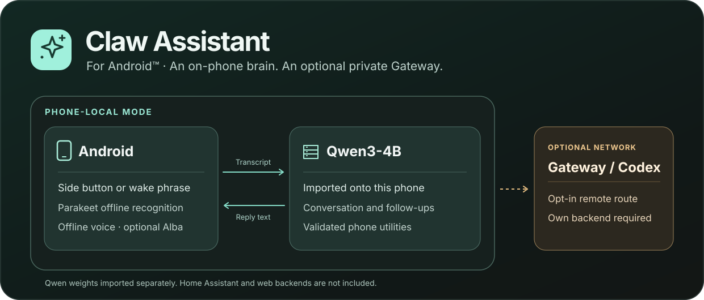
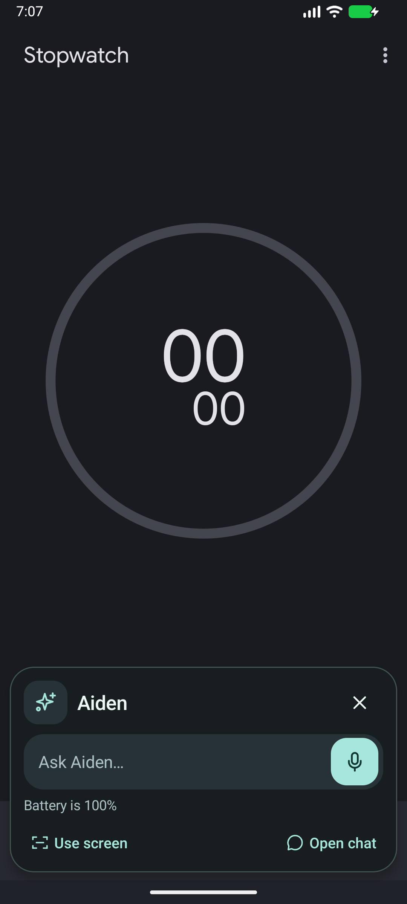

<h1 align="center">Claw Assistant for Android™</h1>

<strong>Bring OpenClaw to your Android Side button.</strong>

Developer preview · Galaxy S24 Ultra · Built on OpenClaw

  <a href="#quick-start">Quick start</a> ·
  <a href="docs/demo.md">Try the demo</a> ·
  <a href="android/README.md">Android build</a> ·
  <a href="gateway/README.md">Gateway setup</a>

  

Hold the Side button to open the assistant over the app you’re using. On-device speech recognition turns your words into text. Your own OpenClaw Gateway returns a reply, and the phone reads it aloud and listens for a follow-up. In this preview, the assistant appears as **Aiden** on your phone and wakes when you say **“Hey Aiden”** with hands-free listening armed.

## What you can try

| On your phone | What Aiden does |
| --- | --- |
| Hold the Side button | Opens the assistant panel over the current app. |
| Say “Hey Aiden” with hands-free listening armed | Opens the panel and starts a live conversation with the Gateway agent. |
| Say “Open Calculator” or “Set a timer for five minutes” | Runs a supported utility on the phone. |
| Say “How much free storage does the host have?” | Reads the host filesystem through the optional Gateway plugin. |
| Say “Think it through” and ask a question | Requests local Ollama reasoning if configured. |
| Say “Ask Codex” and ask a question | Sends the question to Codex if configured and returns the answer in the same conversation. |

   
  Aiden reads the battery level on a fresh Android 36.1 emulator.

## Quick start

1. Prepare the pinned OpenClaw Android checkout and build the preview using the [Android guide](android/README.md). It uses Android’s system voice and installs as `ai.openclaw.app.aiden.preview`.
2. Configure a private OpenClaw Gateway and the `aiden-fast` agent. The [Gateway guide](gateway/README.md) has a sample configuration and instructions for the optional plugin.
3. Pair the Android app with your Gateway. In Android, select the preview under **Settings → Apps → Default apps → Digital assistant app**. Samsung’s **Side button** settings can map a long press to the digital assistant.
4. Open the Aiden panel. To arm voice wake, select **Use screen → Hey Aiden hands-free → Start listening** and close the panel. Say **“Hey Aiden”** with your phone unlocked. Choose **End conversation** or say **“stop conversation”** when done.

## Where your data goes

- Wake detection, speech recognition, and system voice playback run on the phone. The system's installed on-device recognizer and voice determine availability.
- The paired Gateway handles conversation text. Use a local model such as Ollama for local inference. The built-in Android screen-context flow asks you to review the material before sending it.
- The optional Codex route sends the question to OpenAI only when you explicitly say **“Ask Codex”** and enable that route. Configure the preview on an authenticated, private Gateway you operate.
- Hands-free wake uses Android’s microphone foreground service and shows a persistent notification with a **Stop** action.

## Preview status

The original prototype was exercised on a Galaxy S24 Ultra running Android 17. See the [demo and validation notes](docs/demo.md) for the checks on this export and the current handset coverage. The public repository supplies source and build instructions.

## Credits

This community preview builds on [OpenClaw](https://github.com/openclaw/openclaw). The [Android guide](android/README.md) records the pinned upstream revision. See the [MIT license](LICENSE) and [third-party notices](THIRD_PARTY_NOTICES.md) for the source and wake dependencies.

Android is a trademark of Google LLC.
